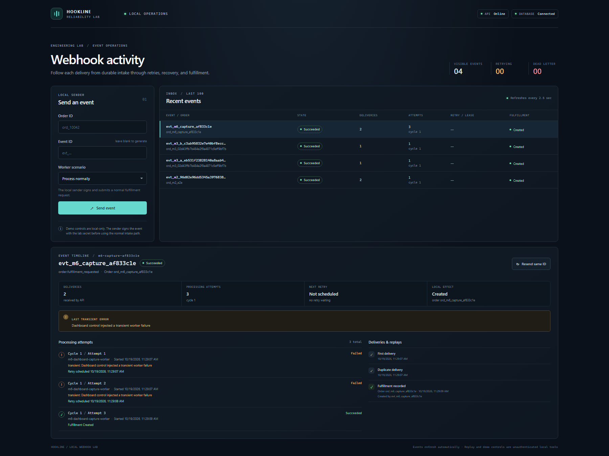
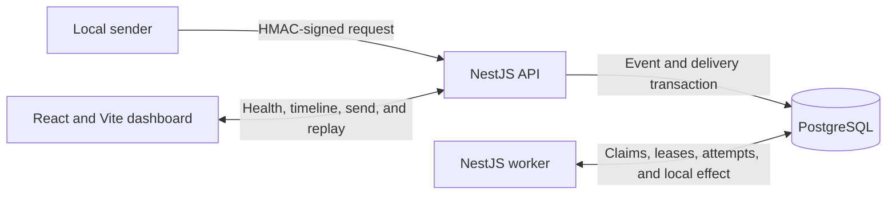

# Webhook Reliability Lab

A local-first engineering demo of reliable webhook intake and processing. It makes duplicate deliveries, transient failures, worker crashes, retry exhaustion, and replay visible in a small API, PostgreSQL-backed worker, and operations dashboard.



## What it demonstrates

- HMAC-SHA256 verification over the raw request body.
- Durable intake: the API records the inbox event and each delivery in one PostgreSQL transaction before returning `202 Accepted`.
- Event deduplication by `(source, event_id)` and local effect idempotency by `(order_id, action)`.
- Separate worker processes claiming work with PostgreSQL `FOR UPDATE SKIP LOCKED` and expiring leases.
- Attempt history, bounded exponential backoff with jitter, expired-lease recovery, dead-letter handling, and audited replay.
- A React dashboard for inspecting delivery, attempt, retry, replay, and fulfillment state.

## Architecture



The event, processing history, and simulated fulfillment live in PostgreSQL so the transaction boundaries are inspectable. The local uniqueness guarantee ends at that database; this project does not claim exactly-once execution or remote side-effect delivery.

## Requirements

- Node.js 24.x and npm.
- Docker Desktop or another Docker Compose installation.
- PowerShell examples below assume Windows; the npm scripts are cross-platform.

## Quick start

Run these commands from the project root:

```powershell
Copy-Item .env.example .env
npm ci
npm run db:up
npm run db:migrate
npm run build
```

If `.env` already exists, keep it and skip `Copy-Item`. `.env` is ignored by Git; use `.env.example` as the local template. The defaults use PostgreSQL on port `5432`.

Start each service in a separate terminal:

```powershell
npm run dev:api
```

```powershell
npm run dev:worker
```

```powershell
npm run dev:web
```

Open <http://localhost:5173>. The API health endpoint is <http://localhost:3000/health>.

## Try the dashboard

1. Enter an order ID and leave Event ID blank so the sender generates a new ID.
2. Select **Inject two transient failures** and click **Send event**.
3. Wait for the selected event to succeed on attempt 3. The timeline shows both failures and their retry times.
4. Click **Resend same ID**. The delivery count increases while the inbox event and local fulfillment remain singular.
5. To try dead-letter replay, select **Exhaust retries to dead letter**, send a fresh event, wait for five failed attempts, enter a replay reason, and click **Replay event**. The next processing cycle retains the earlier attempt history.

The dashboard refreshes event and timeline data every 2.5 seconds. For the crash scenario, the worker exits after claim with code 86. Start a normal worker after the lease expires; the development watcher does not automatically restart this failpoint.

## Run the end-to-end verification

With PostgreSQL running and migrations applied, run:

```powershell
npm run verify:e2e
```

The verifier starts isolated API and worker processes and checks invalid signatures, database outage, 20 concurrent duplicate deliveries, two-worker processing, transient recovery, worker termination and lease recovery, retry exhaustion, and replay. It uses unique test data and removes its rows and temporary claim-delay trigger on ordinary completion or assertion failure. Run one verifier at a time. It does not stop the PostgreSQL container.

Verified on Node.js 24.20.0 with `npm run db:migrate`, `npm run build`, and `npm run verify:e2e` on 2026-10-19. The observed results are recorded in [the demo handoff](docs/demo-handoff.md).

## API and data contract

The provider-neutral event shape, raw-body signature format, status transitions, worker behavior, retry settings, and replay request are documented in [the event contract](docs/event-contract.md). The signed intake endpoint is `POST /webhooks`; the dashboard uses the local-only `POST /webhooks/demo` route. Inspect an event with `GET /webhooks/timeline?source=<source>&eventId=<eventId>`.

SQL migrations live in `apps/api/migrations`. Apply them with `npm run db:migrate`; they are safe to rerun.

## Configuration and local safety

Copy `.env.example` to `.env` to configure the local PostgreSQL port, database URL, HMAC secret, worker lease and poll intervals, and retry limits. If port `5432` is occupied, change both `WEBHOOK_LAB_POSTGRES_HOST_PORT` and the port in `WEBHOOK_LAB_DATABASE_URL` to the same available port.

The signature scheme is for this lab and is not compatible with Stripe, GitHub, or another provider. Dashboard demo and replay endpoints have no operator authentication. Keep the API and dashboard on a trusted local machine and do not expose them to an untrusted network. This project does not test production authentication, provider-specific retry behavior, remote side effects, arbitrary event ordering, or throughput.

Stop the database with `npm run db:down`; stop the API, worker, and dashboard with Ctrl+C in their terminals.
